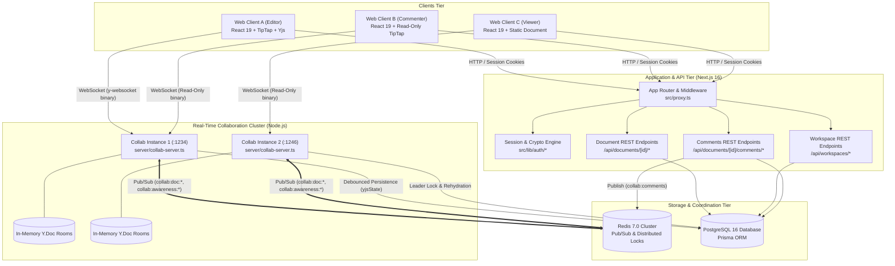
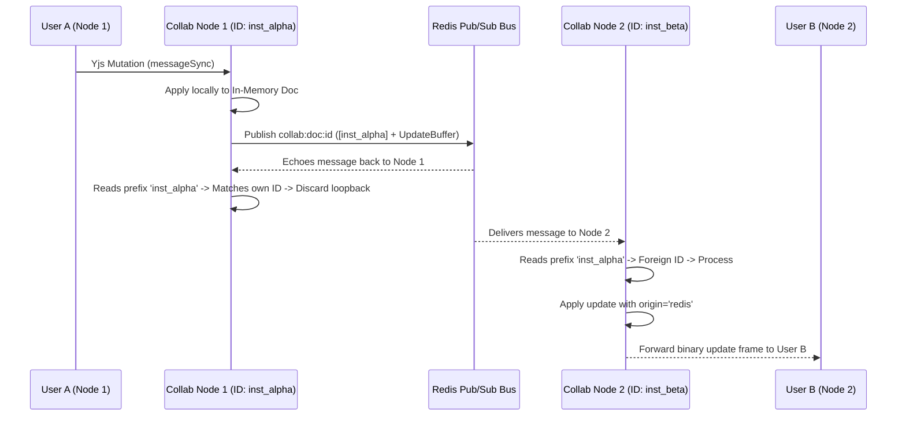

# CollabSpace Architecture & Technical Specification

This document provides a comprehensive technical breakdown of the architecture, data models, state synchronization protocols, and security boundaries implemented in CollabSpace.

---

## 1. System Topology Overview

CollabSpace is engineered around a distributed, decoupled topology where compute concerns (HTTP routing, authentication, SSR) are isolated from real-time state synchronization (WebSocket multiplexing, CRDT resolution, ephemeral presence).



---

## 2. Frontend Architecture (Next.js 16 & React 19)

### Routing & Hydration Paradigm
CollabSpace leverages Next.js 16 App Router with React 19 Server and Client Components:
- **Server Components**: Marketing landing page (`src/app/page.tsx`), layout headers, and shell wrappers optimize time-to-first-byte (TTFB).
- **Client Components (`'use client'`)**: Interactive editors (`src/components/editor/tiptap-editor.tsx`), live comments sidebar (`src/components/editor/comments-sidebar.tsx`), and floating bubble menus (`src/components/editor/floating-bubble-menu.tsx`) encapsulate reactive browser lifecycles.

### TipTap Rich-Text Engine
The editing canvas is built atop TipTap 3, a headless, modular rich-text framework powered by ProseMirror:
- **Extensions Configured**: `StarterKit`, `Underline`, `Link`, `TaskList`, `TaskItem`, `TextAlign`, `Placeholder`, `CharacterCount`, `Collaboration`, and `CollaborationCaret`.
- **Custom DOM Markings**: Inline link security wrappers convert malicious URI schemes (e.g., `javascript:`) to safe anchors during editing.

---

## 3. Real-Time CRDT Synchronization (Yjs)

### Why CRDTs Over Operational Transformation (OT)
CollabSpace utilizes **Yjs** (Conflict-Free Replicated Data Types) rather than centralized Operational Transformation (OT) used in legacy architectures:
1. **P2P Convergence**: Any two replicas that have received the exact same set of updates are guaranteed to be in the exact same state, regardless of the arrival order of packets.
2. **Zero Central Lock Contention**: Clients can type concurrently without acquiring a write lock on the server.
3. **Offline Re-alignment**: A user who disconnects or undergoes a network partition can continue modifying their local `Y.Doc`. Upon reconnection, missing vector clocks are exchanged via `SyncStep1` and `SyncStep2`, deterministically merging the document with 0% data loss.

### Binary Wire Protocol (`y-websocket`)
Communication between the browser and the collaboration server takes place over WebSockets using binary-encoded protocol messages (`lib0/encoding` and `lib0/decoding`):
- `messageSync (0)`: Carries sync step requests or raw Yjs document update buffers.
- `messageAwareness (1)`: Carries ephemeral user presence, cursor locations, and selections.
- `messageAuth (2)`: Carries authentication challenge and permission rejection frames (`writePermissionDenied`).
- `messageComment (3)`: CollabSpace custom extension frame broadcasting live comment creation, reply additions, and resolution updates.

---

## 4. WebSocket Collaboration Server (`server/collab-server.ts`)

The collaboration server is an independent Node.js process:
- **In-Memory Document Cache**: Active rooms are cached in memory as `WSSharedDoc` instances (subclasses of `Y.Doc`).
- **Connection Handshake**:
  1. On connection, the client supplies `token` via URL parameters or session cookies.
  2. The server calls `validateSessionToken(rawToken)` against PostgreSQL.
  3. The server calls `verifyDocumentAccess(user.id, docId, 'viewer')` to determine the user's role and write authority.
  4. Non-editor connections have `canWrite = false` tagged in their connection context.
- **Wire-Level RBAC Enforcement**:
  When a message arrives with `msgType === messageSync`:
  ```ts
  if (!context.canWrite && syncSubtype === syncProtocol.messageYjsUpdate) {
    const authEncoder = encoding.createEncoder();
    encoding.writeVarUint(authEncoder, messageAuth);
    authProtocol.writePermissionDenied(authEncoder, 'Permission denied: document is read-only');
    send(conn, encoding.toUint8Array(authEncoder));
    return; // Drop unauthorized mutation
  }
  ```

---

## 5. Persistence Strategy & Cold-Boot Rehydration

### Debounced Dual-Format Persistence
Documents are saved to PostgreSQL in two representations:
1. **Binary CRDT State Vector (`yjsState: Bytes`)**: Complete lossless Yjs state vector used for cold-boot rehydration and exact delta calculations.
2. **Human-Readable Text / JSON (`content: Text`)**: Extracted paragraph text or JSON structure used for dashboard previews, search indexing, and export.

### Persistence Lifecycle:
1. When an editor sends an update, `doc.isDirty` is set to `true` and a 2000ms debounce timer starts.
2. When the timer fires, the server acquires a Redis distributed lock (`lock:persist:{docId}`).
3. The server writes `Y.encodeStateAsUpdate(doc)` to `Document.yjsState` in PostgreSQL.
4. If a collaboration server crashes, the next connection creates the `WSSharedDoc` and immediately hydrates the full binary state from PostgreSQL:
   ```ts
   if (persistedDoc?.yjsState) {
     Y.applyUpdate(doc, new Uint8Array(persistedDoc.yjsState));
   }
   ```

---

## 6. Redis Multi-Instance Pub/Sub Scaling

To support multiple horizontally scaled collaboration nodes, Redis 7 acts as the shared message bus:



### Loopback Echo Suppression:
Every update published to Redis is prepended with an 8-byte ASCII `INSTANCE_ID` prefix. When a node receives a message from Redis, it checks the first 8 bytes. If the prefix matches its own `INSTANCE_ID`, the message was published by itself and is immediately dropped, preventing infinite reflection loops.

---

## 7. Version History & Checkpoint Architecture

CollabSpace provides immutable version history via `src/lib/snapshots.ts`:
- **Automatic Checkpoint Cap**: Snapshots are retained up to a maximum retention limit (default: 50 versions per document). Excess older versions are pruned to maintain bounded table growth.
- **Differential Non-Destructive Restore**:
  When a user restores to an older version:
  1. A pre-restore safety checkpoint is automatically generated capturing the current state before any rollback occurs.
  2. The target snapshot's binary state is loaded.
  3. The server computes the differential delta between the live room state and the snapshot state.
  4. The delta is applied as a collaborative transaction to the live room. All active connected browsers observe the reversion in real time without refreshing or dropping connections.

---

## 8. Real-Time Comments Architecture

```mermaid
flowchart LR
    subgraph ClientCommenter["Commenter Browser"]
        SelectText["Select text & click comment"] --> PostREST["POST /api/documents/:id/comments"]
    end

    subgraph APITier["Next.js REST API"]
        PostREST --> ValidateRBAC["Verify userRole in (owner, admin, editor, commenter)"]
        ValidateRBAC --> Sanitize["Sanitize HTML & Neutralize Event Handlers"]
        Sanitize --> InsertDB["Insert into PostgreSQL comments table"]
        InsertDB --> PubRedis["Publish to Redis 'collab:comments'"]
    end

    subgraph PubSubTier["Redis & WebSocket Servers"]
        PubRedis --> BroadcastWS["Collab Servers receive Redis event"]
        BroadcastWS --> DispatchClient["Send binary frame (messageComment = 3)"]
    end

    subgraph ClientEditor["Editor Browser"]
        DispatchClient --> UpdateSidebar["Comments Sidebar updates state in real-time"]
    end
```



### Comment Anchoring System:
- **Quote-Based Highlighting**: Stores `quote` (the selected text) and `anchorPosition` (metadata hint).
- **DOM Traversal**: On mount, a `TreeWalker` traverses document text nodes (`NodeFilter.SHOW_TEXT`) to match exact quote sequences and apply interactive jump/highlight anchors.
- **Isolation**: Document comment endpoints strictly enforce workspace and document scoping, preventing cross-document data leakage.

---

## 9. Security Architecture & Threat Model

| Threat Vector | Mitigation Strategy | Code Reference |
|---|---|---|
| **Credential Interception** | Bcrypt password hashing (cost factor 12); raw session tokens never stored in DB (only SHA-256 hashes). | `src/lib/auth/crypto.ts` |
| **Privilege Escalation** | Unified `verifyDocumentAccess` helper checks workspace and document membership before mutation. | `src/lib/auth/authorization.ts` |
| **Unauthorized Wire Edits** | Collab server drops binary sync frames from non-editors (`canWrite === false`) and emits `writePermissionDenied`. | `server/collab-server.ts` (L680) |
| **Cross-Site Scripting (XSS)** | `sanitizeHtml` strips `<script>`, `<iframe>`, `<style>`, and inline `on*` event handlers from comments and rich text. | `src/lib/sanitize.ts` |
| **Brute-Force & Denial-of-Service** | Redis-backed sliding-window rate limiters on auth endpoints and WebSocket message rates (500 msgs / 10s). | `src/lib/auth/rate-limit.ts` |
| **Timing Attacks** | Cryptographic verification uses `crypto.timingSafeEqual` for all token comparisons. | `src/lib/auth/crypto.ts` |
