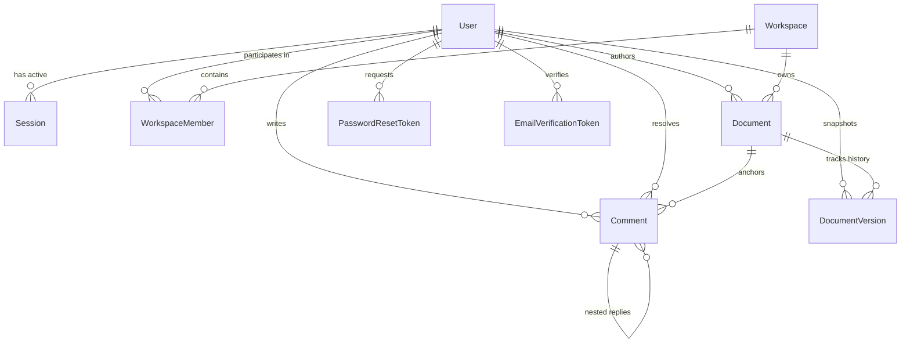

# CollabSpace Database Architecture & Entity Specifications

CollabSpace utilizes **PostgreSQL 16/17** as its primary persistent relational data store, managed and queried via **Prisma ORM 7**.

---

## 1. Entity-Relationship Diagram

---

## 2. Table Specifications

### 2.1. `users` Table
Stores user accounts, authentication credentials, and profile attributes.

| Column | Data Type | Nullable | Default | Description |
|---|---|:---:|---|---|
| `id` | `TEXT (UUID)` | No | `uuid()` | Primary Key |
| `name` | `TEXT` | No | — | User's full display name |
| `email` | `TEXT` | No | — | Unique, lowercase normalized email |
| `passwordHash` | `TEXT` | No | — | Bcrypt hash (cost factor 12) |
| `avatar` | `TEXT` | Yes | `NULL` | Optional avatar image URL or asset key |
| `emailVerified` | `TIMESTAMP` | Yes | `NULL` | Timestamp of email verification |
| `createdAt` | `TIMESTAMP` | No | `now()` | Account creation timestamp |
| `updatedAt` | `TIMESTAMP` | No | `auto` | Last profile update timestamp |

- **Indexes & Constraints**:
  - `UNIQUE (email)`: Enforces unique email accounts at the engine level.

---

### 2.2. `sessions` Table
Tracks active authenticated sessions across devices.

| Column | Data Type | Nullable | Default | Description |
|---|---|:---:|---|---|
| `id` | `TEXT (UUID)` | No | `uuid()` | Primary Key |
| `sessionToken` | `TEXT` | No | — | Unique SHA-256 hash of the bearer token |
| `userId` | `TEXT (UUID)` | No | — | Foreign Key referencing `users(id)` ON DELETE CASCADE |
| `expiresAt` | `TIMESTAMP` | No | — | Absolute session expiration deadline (7 days) |
| `userAgent` | `TEXT` | Yes | `NULL` | Client browser user agent string |
| `ipAddress` | `TEXT` | Yes | `NULL` | Client IP address for audit tracking |
| `createdAt` | `TIMESTAMP` | No | `now()` | Login timestamp |

- **Indexes & Constraints**:
  - `UNIQUE (sessionToken)`: Fast constant-time session lookup.
  - `INDEX (userId)`: Fast retrieval of all sessions belonging to a user (used during password reset session revocation).
  - `INDEX (expiresAt)`: Efficient cleanup of expired session records.

---

### 2.3. `workspaces` Table
Multi-tenant organizational boundary grouping members and documents.

| Column | Data Type | Nullable | Default | Description |
|---|---|:---:|---|---|
| `id` | `TEXT (UUID)` | No | `uuid()` | Primary Key |
| `name` | `TEXT` | No | — | Workspace display title |
| `slug` | `TEXT` | No | — | Unique URL-safe workspace slug |
| `icon` | `TEXT` | No | `🚀` | Workspace emoji or icon identifier |
| `plan` | `TEXT` | No | `Free` | Workspace billing tier |
| `ownerId` | `TEXT (UUID)` | No | — | User ID of the workspace creator |
| `createdAt` | `TIMESTAMP` | No | `now()` | Workspace creation timestamp |
| `updatedAt` | `TIMESTAMP` | No | `auto` | Workspace update timestamp |

- **Indexes & Constraints**:
  - `UNIQUE (slug)`: Unique routing identifier.

---

### 2.4. `workspace_members` Table
Junction table mapping users to workspaces with assigned RBAC permission tiers.

| Column | Data Type | Nullable | Default | Description |
|---|---|:---:|---|---|
| `id` | `TEXT (UUID)` | No | `uuid()` | Primary Key |
| `workspaceId` | `TEXT (UUID)` | No | — | Foreign Key referencing `workspaces(id)` ON DELETE CASCADE |
| `userId` | `TEXT (UUID)` | No | — | Foreign Key referencing `users(id)` ON DELETE CASCADE |
| `role` | `TEXT` | No | `editor` | Assigned role: `owner`, `admin`, `editor`, `commenter`, `viewer` |
| `joinedAt` | `TIMESTAMP` | No | `now()` | Membership establishment date |

- **Indexes & Constraints**:
  - `UNIQUE (workspaceId, userId)`: Prevents duplicate membership records for the same user in a workspace.
  - `INDEX (workspaceId)`: Speeds up member listing queries.
  - `INDEX (userId)`: Speeds up workspace resolution for authenticated users.

---

### 2.5. `documents` Table
Core document entity storing metadata, human-readable text, and binary Yjs state vectors.

| Column | Data Type | Nullable | Default | Description |
|---|---|:---:|---|---|
| `id` | `TEXT (UUID)` | No | `uuid()` | Primary Key |
| `title` | `TEXT` | No | `Untitled Document` | Document title |
| `icon` | `TEXT` | No | `📄` | Document icon |
| `content` | `TEXT` | No | `

` | Rendered HTML/JSON text content |
| `excerpt` | `TEXT` | Yes | `NULL` | Short plain-text summary for cards |
| `yjsState` | `BYTEA (Bytes)` | Yes | `NULL` | Binary CRDT update state vector |
| `workspaceId` | `TEXT (UUID)` | No | — | Foreign Key referencing `workspaces(id)` ON DELETE CASCADE |
| `authorId` | `TEXT (UUID)` | No | — | Foreign Key referencing `users(id)` ON DELETE CASCADE |
| `isStarred` | `BOOLEAN` | No | `false` | Favorite status flag |
| `isDeleted` | `BOOLEAN` | No | `false` | Soft-deletion flag (Trash view) |
| `deletedAt` | `TIMESTAMP` | Yes | `NULL` | Soft deletion timestamp |
| `isArchived` | `BOOLEAN` | No | `false` | Archive status flag |
| `archivedAt` | `TIMESTAMP` | Yes | `NULL` | Archive timestamp |
| `tags` | `TEXT[]` | No | `[]` | Categorization tags array |
| `createdAt` | `TIMESTAMP` | No | `now()` | Document creation timestamp |
| `updatedAt` | `TIMESTAMP` | No | `auto` | Document last modified timestamp |

- **Indexes & Constraints**:
  - `INDEX (workspaceId)`: Rapid document filtering by workspace.
  - `INDEX (authorId)`: Speeds up author-based document queries.

---

### 2.6. `document_versions` Table
Immutable snapshots capturing historical versions of a document.

| Column | Data Type | Nullable | Default | Description |
|---|---|:---:|---|---|
| `id` | `TEXT (UUID)` | No | `uuid()` | Primary Key |
| `documentId` | `TEXT (UUID)` | No | — | Foreign Key referencing `documents(id)` ON DELETE CASCADE |
| `versionNumber`| `INTEGER` | No | — | Incremental version number (1, 2, 3...) |
| `title` | `TEXT` | Yes | `NULL` | Snapshot title |
| `contentSnapshot`| `TEXT` | No | `

` | HTML text snapshot at checkpoint time |
| `yjsSnapshot` | `BYTEA (Bytes)`| Yes | `NULL` | Binary Yjs CRDT state snapshot |
| `changeSummary` | `TEXT` | Yes | `NULL` | Summary description of revisions |
| `addedCount` | `INTEGER` | No | `0` | Number of added characters/words |
| `removedCount` | `INTEGER` | No | `0` | Number of deleted characters/words |
| `authorId` | `TEXT (UUID)` | Yes | `NULL` | User who created checkpoint ON DELETE SET NULL |
| `createdAt` | `TIMESTAMP` | No | `now()` | Checkpoint timestamp |

- **Indexes & Constraints**:
  - `UNIQUE (documentId, versionNumber)`: Prevents collision of version numbers within a document.
  - `INDEX (documentId)`: Fast retrieval of chronological history.
  - `INDEX (createdAt)`: Sorting by checkpoint date.

---

### 2.7. `comments` Table
Stores persistent discussion threads, inline text quotes, and hierarchical replies.

| Column | Data Type | Nullable | Default | Description |
|---|---|:---:|---|---|
| `id` | `TEXT (UUID)` | No | `uuid()` | Primary Key |
| `documentId` | `TEXT (UUID)` | No | — | Foreign Key referencing `documents(id)` ON DELETE CASCADE |
| `authorId` | `TEXT (UUID)` | No | — | Foreign Key referencing `users(id)` ON DELETE CASCADE |
| `parentId` | `TEXT (UUID)` | Yes | `NULL` | Self-referencing FK for replies ON DELETE CASCADE |
| `text` | `TEXT` | No | — | Sanitized comment or reply message |
| `quote` | `TEXT` | Yes | `NULL` | Quoted document text snippet |
| `anchorPosition`| `TEXT` | Yes | `NULL` | Target DOM element identifier hint |
| `resolved` | `BOOLEAN` | No | `false` | Thread resolved flag |
| `resolvedAt` | `TIMESTAMP` | Yes | `NULL` | Resolution timestamp |
| `resolvedById` | `TEXT (UUID)` | Yes | `NULL` | User who marked resolved ON DELETE SET NULL |
| `createdAt` | `TIMESTAMP` | No | `now()` | Creation timestamp |
| `updatedAt` | `TIMESTAMP` | No | `now()` | Last edit timestamp |

- **Indexes & Constraints**:
  - `INDEX (documentId)`: Fast document comment feed retrieval.
  - `INDEX (parentId)`: Fast hierarchical tree assembly for replies.
  - `INDEX (authorId)`: Moderation and authorship validation.

---

### 2.8. Auxiliary Security Tables

- **`password_reset_tokens`**: Stores cryptographic SHA-256 hashes of password reset tokens with timestamps and single-use `usedAt` flags.
- **`email_verification_tokens`**: Stores cryptographic hashes of email verification tokens.
- **`rate_limit_records`**: Fallback rate limiter tracking attempt counts per IP/action key with sliding expiration timestamps.
